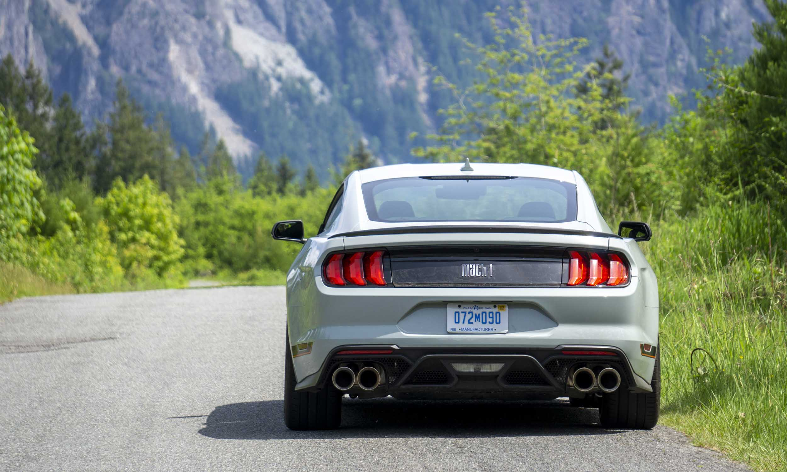
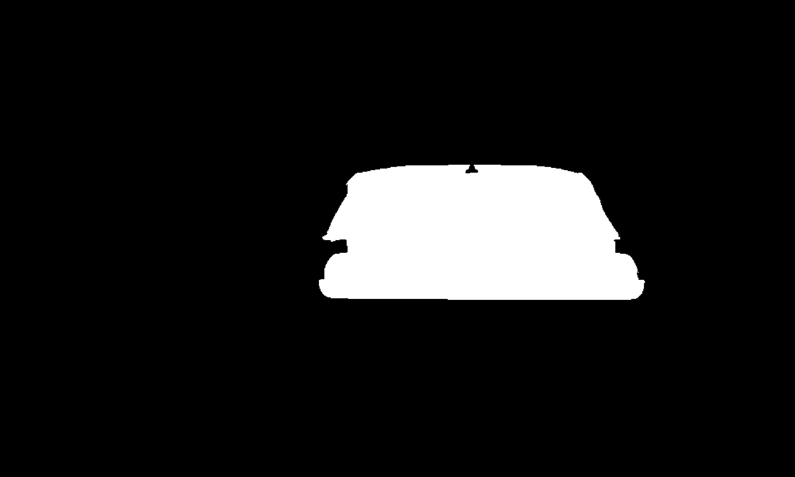
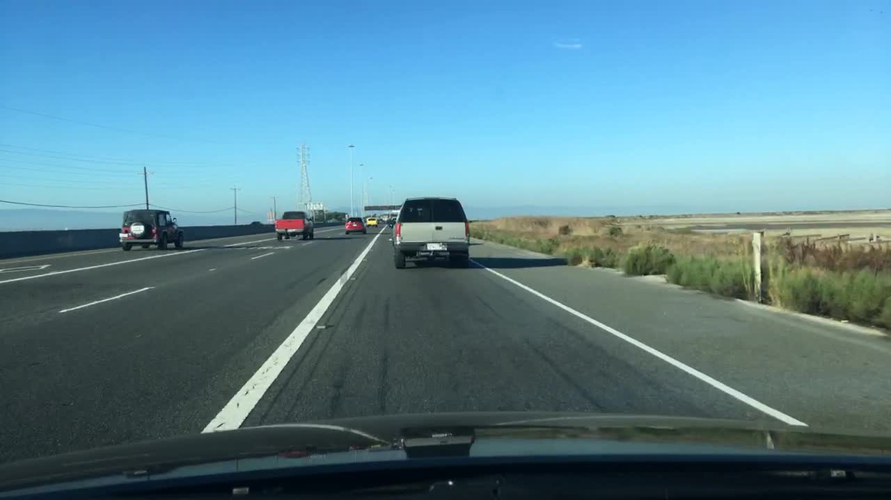
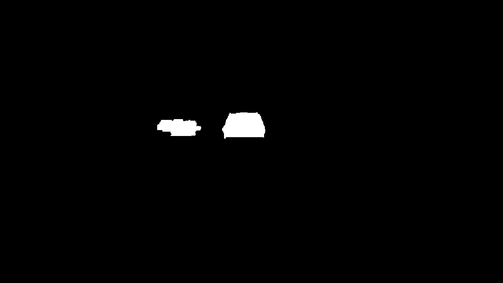
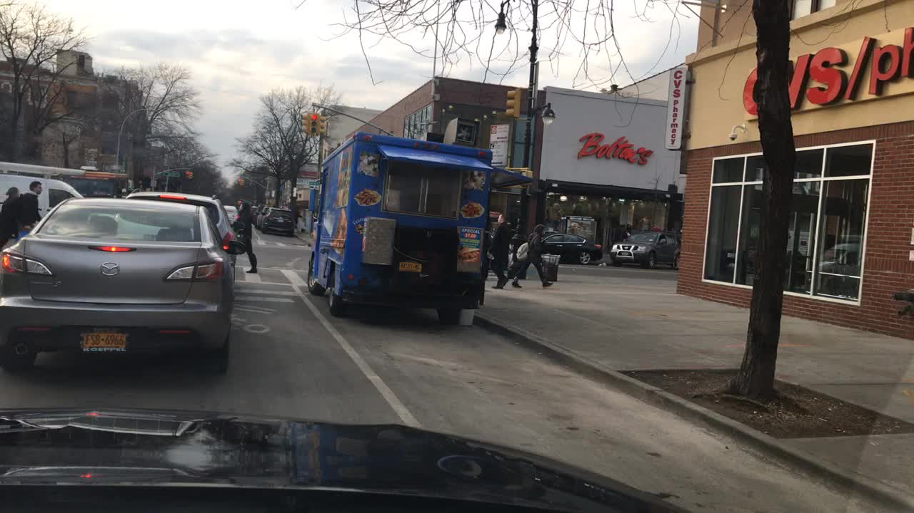
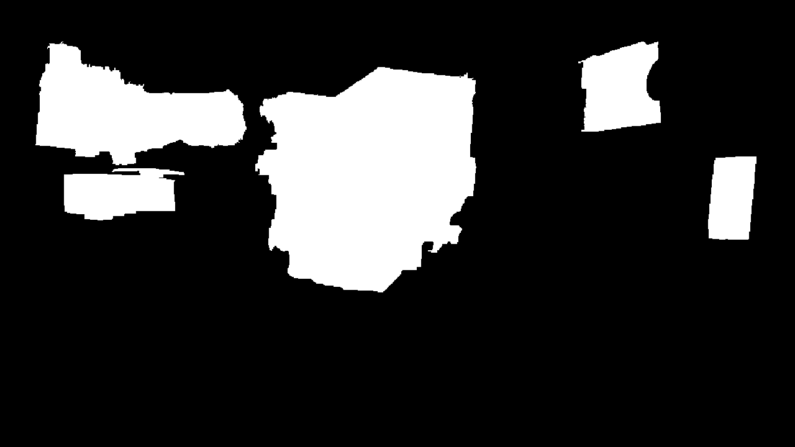
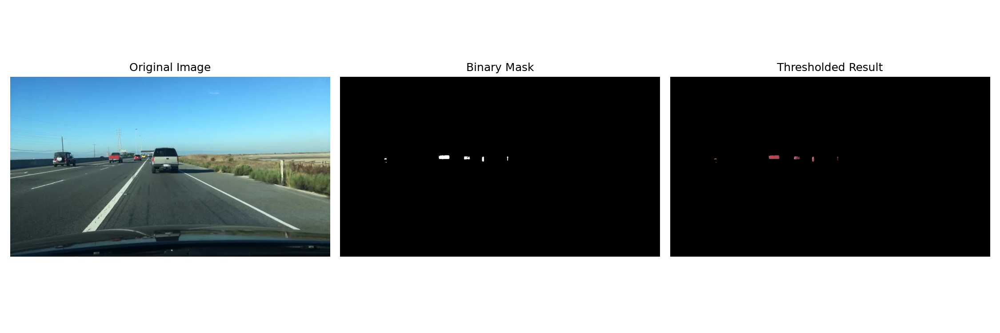
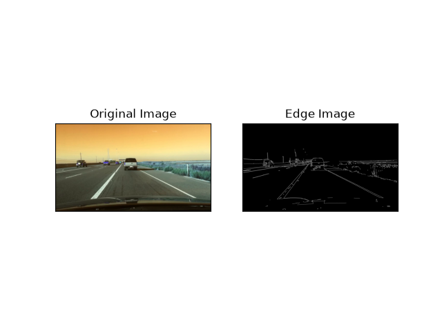

# Traditional Vehicle Segmentation with OpenCV

A traditional computer vision approach to vehicle segmentation using **HSV color thresholding, geometric taillight detection, and GrabCut graph-cut optimization**. Developed as part of the *CLAWtonomous Decisions* Computer Science Comps project at Carleton College, comparing traditional computer vision methods with deep learning approaches such as YOLO26 and SAM 3.

Unlike neural network approaches, this algorithm requires no training data or pretrained model. Instead, it identifies rear-facing vehicles through pairs of red taillights and uses GrabCut to estimate their pixel-level boundaries.

## How It Works

Check the final paper for detailed explanation (available on the project website).

## Usage

Run the algorithm by passing one or more input image paths:

```bash
python main.py input/car.jpg
```

Or process multiple images:

```bash
python main.py input/car.jpg input/dashcam.jpg
```

The program generates a binary mask for each input image, saving it alongside the original with the suffix `_mask.png`.

For example:

```text
input/car.jpg → input/car_mask.png
input/dashcam.jpg → input/dashcam_mask.png
```

The program also prints the output filename and the number of foreground pixels.

To save masks in the `output/` directory instead, change the output path in `main.py`.

## Example Results

### Vehicle Segmentation

| Input | Segmentation Mask |
|---|---|
|  |  |
|  |  |
|  |  |

### Additional Experiments

The repository also contains exploratory implementations of other traditional computer vision techniques.



*Color thresholding comparison.*



*Edge detection experiment.*

## Repository Structure

```text
.
├── main.py                 # Taillight detection + GrabCut
├── colorThreshold.py       # Color thresholding experiment
├── edge.py                 # Edge detection experiment
├── superpixel.py           # Superpixel experiment
├── input/
│   ├── car.jpg
│   ├── CVS.jpg
│   └── dashcam.jpg
└── output/
    ├── car_mask.png
    ├── CVS_mask.png
    ├── dashcam_mask.png
    ├── color_threshold_comparison.png
    └── edgeoutput.png
```